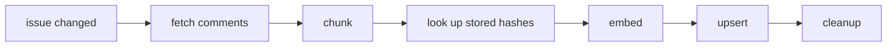

# GitHub Issue Semantic Search

A durable pipeline that indexes every issue and comment in a GitHub repo,
keeps the index current as threads change, and serves it to Claude Code or
Cursor over MCP. Unlike GitHub's own semantic search, which reads only issue
titles and bodies, this also reads the comments and shows you the one that
matched.

Indexing a large repo can take hours, so [Inngest](https://inngest.link/james-murdza-gh)
handles the retries, rate limits, and checkpoints to make sure the process can
resume if it gets interrupted. This example is sponsored by Inngest.

https://github.com/user-attachments/assets/b44263a4-5710-4713-821b-a8d651f50cc1

## Install

You need [uv](https://docs.astral.sh/uv/) and Docker.

```bash
git clone https://github.com/jamesmurdza/github-issue-semantic-search
cd example-projects/gh-issue
uv tool install --editable .
```

That puts `gh-issue` on your PATH. `--editable` means changes to the code take
effect without installing again.

## Quickstart

This runs everything on your machine, with the Inngest dev server. Python,
Qdrant, and embeddings computed locally: no embedding API key, and no
per-token cost.

1. Start Qdrant (the index) and the Inngest dev server:

   ```bash
   docker compose up -d
   ```

2. Tell gh-issue to use the dev server, and give it a GitHub token. For public
   repos, a token with the `public_repo` scope is enough. It asks for the token
   rather than taking it on the command line, and doesn't show it as you type:

   ```bash
   gh-issue config set inngest.dev 1
   gh-issue config set github.token
   ```

3. Start a worker, in its own terminal. It runs the Inngest functions, and
   keeps running until you stop it with Ctrl+C:

   ```bash
   gh-issue worker
   ```

4. Index a repo:

   ```bash
   gh-issue sync inngest/inngest
   ```

   `gh-issue status` shows how far it has got. inngest/inngest (315 issues)
   takes about three minutes, or six the first time, which also downloads the
   embedding model (about 65 MB). To watch every run and step as it happens, open the dev
   server's dashboard at http://localhost:8288.

5. Search:

   ```bash
   gh-issue search cannot run the dev server on windows
   ```

## Running on Inngest Cloud

The worker opens an outbound connection to Inngest and runs whatever work
Inngest hands it (connect mode). Nothing has to reach in, so it runs anywhere
that can reach the internet: no public URL, and no port to open.

1. Get an event key and a signing key from your
   [Inngest](https://inngest.link/james-murdza-gh) account.
2. Point gh-issue at Inngest Cloud:

   ```bash
   gh-issue config unset inngest.dev
   gh-issue config set inngest.event_key
   gh-issue config set inngest.signing_key
   ```

3. If Qdrant is not local, point gh-issue at it:
   `gh-issue config set qdrant.url <url>`.
4. Run `gh-issue worker` wherever it should live, and `gh-issue sync` as before.

## Use it from Claude Code or Cursor

The MCP server gives an agent three read-only tools:

- `search_issues` searches, with optional filters: repos, open or closed,
  labels, author, body or comment, and a start date.
- `get_issue` reads a whole thread.
- `status` says what is synced.

Claude Code:

```bash
claude mcp add --scope user gh-issue -- gh-issue mcp stdio
```

Cursor, in `~/.cursor/mcp.json`:

```json
{
  "mcpServers": {
    "gh-issue": { "command": "gh-issue", "args": ["mcp", "stdio"] }
  }
}
```

The agent starts the server itself. For an agent that connects to a running
server instead, `gh-issue mcp http` serves the same tools over streamable HTTP
at `http://127.0.0.1:8000/mcp`.

## Compare it with GitHub's search

```bash
gh-issue web
```

Open http://127.0.0.1:8080, choose one of your synced repos and type a
question. The page sends it to GitHub's own issue search and to this index,
for that repo, and shows the two lists side by side. A result that GitHub's
list does not have says so. When the first result is a comment, the comment is
shown, with its author's picture loaded from github.com.

The address keeps the repo and the question, so a bookmark opens on the same
search.

GitHub's list comes from its search API in hybrid mode, with the same
`github.token`. GitHub allows 10 of those searches a minute. Past that, the
page counts down and asks again.

## Commands

| command | what it does |
|---|---|
| `gh-issue config` | `config list` shows the settings and `config get` one of them; `config set` and `config unset` change them. |
| `gh-issue worker` | Run the Inngest functions. Nothing is indexed unless a worker is running. |
| `gh-issue sync owner/name` | Index a repo, or bring it up to date. With no repo named, it syncs every repo synced before. Safe to run again at any time. |
| `gh-issue status` | What is synced, how far each backfill has got, whether a worker is up, and how many issues failed. |
| `gh-issue remove owner/name` | Take a repo out of the index and stop syncing it. |
| `gh-issue search <words>` | Search every synced repo. `--repo` (`-R`), `--state` (`-s`), `--label` (`-l`), `--author` (`-A`), `--kind` and `--since` filter, as in `gh issue list`; `--limit` (`-L`) sets how many results, 1 to 50. |
| `gh-issue mcp stdio` | Serve the index over MCP, for an agent that starts the server itself. |
| `gh-issue mcp http` | The same over streamable HTTP, for an agent that connects to a running server. |
| `gh-issue web` | Show GitHub's own issue search and the index side by side, in a browser, for any synced repo. |

`gh-issue <command> --help` has the details, and examples.

Example usage:

```
$ gh-issue search event key not recognized
1. inngest/inngest#3129 (closed) Inngest start event key not recognized
   comment by digitalbase on 2026-03-21
   Great will try it. Do you get `rejecting event; event key not recognized` errors in your log?
   https://github.com/inngest/inngest/issues/3129

2. inngest/inngest#2819 (closed) Unable to start inngest in prod mode
   ...
```

## Settings

`gh-issue config list` shows every setting, its value (secrets masked), where
the value came from and what it is for; `gh-issue config get <setting>` prints
one value.

| setting | what it is | default |
|---|---|---|
| `github.token` | a GitHub token | none |
| `inngest.dev` | `1` for a local dev server, or its URL | not set: Inngest Cloud |
| `inngest.event_key` | Inngest Cloud's event key | none |
| `inngest.signing_key` | Inngest Cloud's signing key | none |
| `qdrant.api_key` | a hosted Qdrant's API key | none |
| `qdrant.url` | where Qdrant is | `http://localhost:6333` |

They are kept in `~/.gh-issue/config.toml`. Each also has an environment
variable (`GITHUB_TOKEN`, `INNGEST_DEV`, `INNGEST_EVENT_KEY`,
`INNGEST_SIGNING_KEY`, `QDRANT_API_KEY`, `QDRANT_URL`), which wins over the
file. The same directory holds the sync records and the embedding model, and
`GH_ISSUE_HOME` moves all of it.

The Qdrant in `docker-compose.yml` needs no key. To use a hosted one instead,
such as a Qdrant Cloud cluster, set its address and its key:

```bash
gh-issue config set qdrant.url https://your-cluster.cloud.qdrant.io:6333
gh-issue config set qdrant.api_key
```

## How it works

Every issue goes through one Inngest function, `index-issue`, whatever started
it. It writes only what changed:



The issue body and each comment become their own chunk. A hash of each chunk's
text shows which ones changed since the last run, so only those are embedded
and written. `cleanup` deletes the chunks the issue no longer has, such as a
comment that was deleted.

The pipeline has four requirements, and Inngest covers each one:

1. **Index what's already there.** A large repo takes hours to index, and the
   work will be interrupted. `backfill-page` fetches one page of issues, hands
   each issue to `index-issue` with `step.send_event`, and sends itself the
   cursor for the next page. Each run stays short, and an interrupted backfill
   resumes at the page it stopped on: `gh-issue sync` restarts it.
2. **Keep up with changes.** `reconcile` runs every hour (`TriggerCron`) and
   starts a `sweep-repo` run for each synced repo. That run asks GitHub for the
   issues changed since the last sweep, and hands each one to `index-issue`.
   `gh-issue sync` runs a sweep straight away.
3. **Stay inside GitHub's rate limit.** Everything shares the token's 5,000
   calls an hour. Every issue gets its own run and its own retries, and a
   `Throttle` on each function keeps the total inside the limit: 4,500 an hour
   for `index-issue`, 250 for paging, the rest for the sweep.
4. **Don't lose work when a run dies.** Every network call and every write is
   its own `step.run`, checkpointed on its own, so a retry starts from the step
   that failed. Embedding, the expensive part, is never paid for twice. The
   write and the cleanup are separate steps, so a run that dies between them
   deletes the old chunks on its retry, rather than leaving them in the index.

Two more guards keep the index consistent:

- **One run per issue at a time.** `singleton` in cancel mode means a newer
  change to an issue cancels the run already working on it. Two runs at once
  would undo each other's writes.
- **Failures are kept, not lost.** An issue that fails every retry is recorded
  by an `on_failure` handler. `gh-issue status` counts them, and the next
  `gh-issue sync` tries them again.

**Search** runs two searches at once and merges them in Qdrant. An embedding
(bge-small, running locally) finds text that means the same thing; BM25 finds
text that uses the same words, such as an exact error message. Neither alone
was as good as both: [`benchmark/`](benchmark/README.md) has the numbers, and
the scripts to reproduce them.

## Limits

- **One rate limit for every repo.** GitHub's limit belongs to the token, not
  the repo, so the throttle has no key. Syncing two repos at once shares one
  budget.
- **Embedding runs on your CPU.** inngest/inngest (315 issues) took about three
  minutes; pydantic/pydantic-ai (3,367 issues) about 45. While a backfill is
  embedding, CLI commands take seconds rather than a moment to answer, because
  the model keeps every core busy.
- **Long threads work, up to a point.** Chunks are embedded 200 at a time,
  because a step can return at most 4 MB, so a thread of any length fits. The
  next ceiling is a run's total state, 32 MB, somewhere past 3,000 comments on
  one issue.
- **The embedding model reads the first 512 tokens of a chunk.** A long
  comment, usually a pasted log, is embedded by its opening; BM25 still reads
  all of it. The model is fixed in this example.

## Development

```bash
uv sync
uv run pytest
```

One test opens the web page in Chromium. If Playwright has no Chromium on your
machine yet, install it once:

```bash
uv run playwright install chromium
```

Apart from that the tests need nothing running: they open Qdrant in embedded
mode, in a temporary directory, and never touch your `~/.gh-issue`. To run the index tests
against a real Qdrant server instead:

```bash
GH_ISSUE_TEST_QDRANT_URL=http://localhost:6333 uv run pytest tests/index/test_store.py
```

The Qdrant dashboard is at http://localhost:6333/dashboard.
